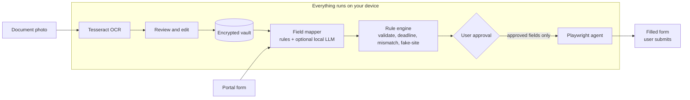

<div align="center">

# 🛡️ VaultPilot

**Fill any government form once, safely. Your data stays on your device.**

A local-first AI agent that reads your ID documents, keeps them in an encrypted vault on your own machine,
and fills government-portal forms for you, with a human approval gate before anything is entered.

`wHACKiest 2026` · Track: *Beyond the Browser: Reimagine How We Use the Web* · Team **Bit wizards** · Team ID `b435d1d1`

</div>

---

## The problem

Filing a government form in India means retyping the same details (name, address, PAN, Aadhaar) on every portal.
One wrong digit gets a form rejected. Rules and deadlines are written in dense official language, so people miss them.
To cope, people upload their Aadhaar and PAN scans to cloud chatbots, cyber cafés, or unknown websites, and
look-alike fake portals are an active threat.

Existing tools each cover only part of this. DigiLocker stores documents but does not fill or check forms.
Cloud AI chatbots explain forms but your IDs leave your device. Browser autofill does not know government form rules.

## The solution

VaultPilot is an agent that never sends your documents anywhere. Everything runs on your own machine.

| Step | What happens | Why it is safe |
|---|---|---|
| **1. Scan** | On-device OCR reads your Aadhaar or PAN photo and extracts the fields. | The original image is never uploaded or stored. |
| **2. Store** | Confirmed fields go into an encrypted local vault. | No server exists, so there is nothing to breach. |
| **3. Understand** | The agent reads the portal form and maps each field to your vault. | A local model, if used, sees only field *labels*, never your values. |
| **4. Warn** | A rule engine checks your data and the portal before anything is filled. | Rules run outside the AI, so the model cannot override them. |
| **5. Fill and approve** | You see every value, edit or untick any, and approve. The agent fills the form and **stops**. | You press Submit yourself. OTP and CAPTCHA are always left to you. |

## Features

- **On-device OCR** with Tesseract (English, plus Hindi if the language pack is installed)
- **Encrypted vault** (Fernet). The key lives in the OS keychain, with a locked key-file fallback. One-click wipe.
- **Smart field mapping** with keyword rules, plus an optional local LLM (Ollama) for fields the rules cannot place
- **Per-field consent.** Only the fields you tick are entered, and the form gets nothing else.
- **Pre-submit warnings in plain language**
  - Aadhaar checksum (Verhoeff) catches mistyped or misread digits
  - PAN, mobile, PIN code, email and date-of-birth format checks
  - Name or date-of-birth mismatch between your documents
  - Deadline within 7 days, or already passed
  - Required documents missing from your vault
  - Fake or look-alike portals: non-`gov.in` domains, non-HTTPS, punycode tricks
- **Never bypasses OTP, CAPTCHA or password fields.** They exist to protect you, so they are handed back to you.
- **Audit log** of which portal received which field *names*. Values are never logged.

## Architecture



Only the fields a form needs reach the browser agent, and each use is logged. If one portal is ever compromised,
the rest of your vault is not exposed.

## Tech stack

| Layer | Choice |
|---|---|
| Backend | Python, FastAPI (bound to `127.0.0.1` only) |
| OCR | Tesseract via `pytesseract` |
| Vault | `cryptography` (Fernet) with `keyring` for the key |
| Local AI (optional) | Ollama with a 7B model (default `qwen2.5:7b`) |
| Browser agent | Playwright (Chromium) |
| Rule engine | Plain Python, deliberately separate from the model |
| Interface | Single-page review panel (vanilla HTML/JS) |

## Quick start

**Requirements:** Python 3.10+, [Tesseract](https://github.com/UB-Mannheim/tesseract/wiki) (Windows), `brew install tesseract` (macOS) or `sudo apt install tesseract-ocr` (Linux).

```bash
git clone https://github.com/<your-username>/vaultpilot.git
cd vaultpilot

python -m venv .venv
source .venv/bin/activate          # Windows: .venv\Scripts\Activate.ps1
pip install -r requirements.txt
playwright install chromium

python samples/make_samples.py     # creates FAKE sample ID images
python -m uvicorn app.main:app --host 127.0.0.1 --port 8000
```

Open **http://localhost:8000**.

### Try the demo (about 2 minutes)

1. **Scan.** Upload `samples/sample_aadhaar.png`, check the extracted fields, click **Save to encrypted vault**. Repeat with `sample_pan.png`.
2. **Add contact details.** The sample IDs have no phone, email or address. Type them in, set the type to `other`, and save.
3. **Read the form.** Click **Read form** on the pre-filled demo portal. You will see a deadline warning and a table of which vault value goes into which field. The OTP box is marked as yours to fill.
4. **Approve.** Click **Approve and fill in browser**. A browser opens with the form filled and highlighted. It never submits.
5. **Catch a fake.** Paste `http://scholarships-gov.in.verify-now.com/refund` and click **Read form** to see the fake-portal warning.

### Optional: local AI

```bash
ollama pull qwen2.5:7b
```

VaultPilot detects Ollama automatically. Without it, keyword rules handle the field mapping.

### Tests

```bash
pytest -q
```

Nine tests cover validation rules, OCR field extraction, form mapping, fake-portal detection, and a check that the vault file contains no plaintext.

## Privacy and safety design

- **No cloud calls.** OCR, vault, mapping and filling are all local. The server listens on localhost only.
- **Documents are not kept.** Images are read in memory and discarded. Only fields you confirm are stored.
- **Encrypted at rest.** The vault file is unreadable without the key held in your OS keychain.
- **Human in the loop.** Nothing is entered without your approval, and the agent never clicks Submit.
- **Safety rules live outside the model.** A wrong guess by the AI cannot skip a validation or a warning.
- **Auditable.** Every fill records the portal and field names, never values. **Wipe everything** deletes the vault and its key.

## Prototype scope vs. the pitch

This repo is a working prototype built within the hackathon. It proves the full loop on one demo form.

| Pitch | Prototype today |
|---|---|
| Chrome extension plus React panel | Local web panel; the agent drives its own Chromium window |
| SQLite with SQLCipher | Fernet-encrypted file (avoids native build steps; same idea) |
| Works on live portals | Demo portal and public forms; pages behind a login are not read yet |
| Llama or Qwen via Ollama | Supported and optional; rules handle mapping when no model is running |
| OCR for scanned papers | Works well on clean images; phone photos with glare or angle need more preprocessing |

## Roadmap

- Read the live DOM through Playwright after the user logs in, to support real portals
- Chrome extension front end
- Community-maintained field maps for new portals
- Multiple profiles in one vault, for families, CAs and CSC centres
- SQLCipher storage
- Stronger OCR cleanup for phone photos, and more document types (marksheets, certificates)

## Project layout

```
app/
  main.py      FastAPI endpoints
  ocr.py       Tesseract and field extraction
  vault.py     Encrypted vault and audit log
  mapper.py    Form parser, field-to-vault mapping, optional Ollama
  rules.py     Validators, mismatch, deadline and fake-portal checks
  agent.py     Playwright filler (never submits)
  static/      Review panel
  portal/      Mock government portal for the demo
samples/       Fake ID generator (synthetic data only)
tests/
```

## Team

| Name | Role |
|---|---|
| Shrihari Paga | Team lead |
| *add name* | *add role* |
| *add name* | *add role* |
| *add name* | *add role* |

JSS Science and Technology · wHACKiest 2026

## Disclaimer

VaultPilot is a hackathon prototype. The demo portal is a mock and nothing is submitted anywhere.
The sample IDs are synthetic. Do not commit real documents; the vault folder and generated sample images are git-ignored.
VaultPilot does not bypass OTPs, CAPTCHAs or any portal security check, and it is not affiliated with any government body.
